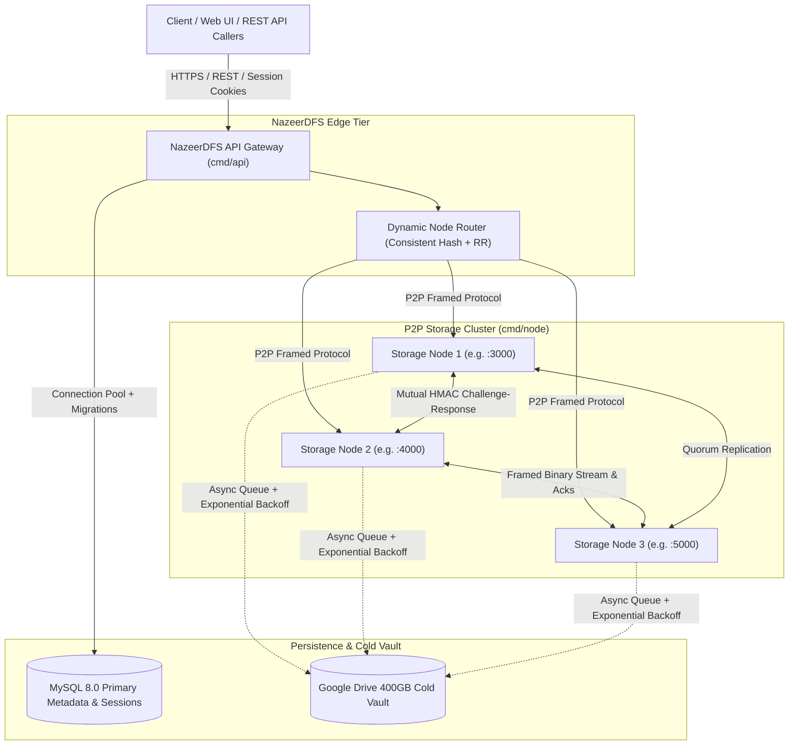

# NazeerDFS Architecture

NazeerDFS is a peer-to-peer, content-addressed distributed file storage system implemented in Go. It provides client authentication, role-based authorization, authenticated chunked encryption at rest, framed binary P2P replication with mutual HMAC authentication, MySQL metadata persistence with versioned migrations, and an asynchronous Google Drive cloud backup tier.

---

## 1. System Topology & Architecture Overview



### Components
1. **API Server (`cmd/api`)**: Dedicated HTTP service hosting the responsive Web UI and JSON REST endpoints. Enforces session validation, bcrypt passwords, double-submit CSRF tokens, strict ownership authorization, rate limiting, and HTTP timeouts.
2. **Storage Nodes (`cmd/node`)**: Autonomous headless storage engines. Each node maintains its own directory structure, authenticates cluster peers using mutual HMAC handshakes, streams framed data frames, and enforces write quorum.
3. **Unified Server (`cmd/main.go`)**: Development and single-container orchestrator that initializes storage nodes and the HTTP service within a single process.
4. **MySQL Database**: Primary source of truth for user authentication, session state, audit logs, and file metadata with reference-counted deduplication.
5. **Google Drive Cloud Tier**: Secondary asynchronous cold storage tier for disaster recovery with exponential backoff retries.

---

## 2. Content-Addressed Storage (CAS) & Deduplication

Files in NazeerDFS are content-addressed and namespaced per user:

$$\text{CAS Key} = \text{SHA-256}(\text{owner} \parallel ":" \parallel \text{SHA-256}(\text{plaintext}))$$

- **Namespaced CAS**: Two users uploading identical file contents receive isolated namespaced keys, ensuring strict cross-user privacy.
- **Deduplication & Reference Counting**: When a user uploads identical content multiple times, the server detects the existing CAS key, avoids duplicate disk writes, and increments `ref_count` in MySQL. Deletion decrements the count and only purges disk ciphertext when `ref_count` reaches zero.
- **Two-Level Directory Sharding**: Files on disk are sharded into hierarchical subdirectories based on slices of the key (e.g., `43944/2146f/...`) to avoid filesystem inode bottlenecks.

---

## 3. Cryptography & Data at Rest Protection

All data written to disk or transmitted over P2P replication streams is encrypted with authenticated chunked encryption before local storage:

```
+------------------------------------------------------------------------+
|                      NazeerDFS Ciphertext Format                       |
+--------+---------+--------+-----------------+--------------------------+
| Magic  | Version | Key ID | Base Nonce      | Encrypted Chunks         |
| "NDFS" |  0x01   | (str)  | 12 Bytes Random | (64KB Chunks with Poly)  |
+--------+---------+--------+-----------------+--------------------------+
```

1. **Header**: Magic bytes `NDFS`, format version `0x01`, key identifier (e.g. `k1`), and a 12-byte cryptographically secure random base nonce.
2. **Chunked AES-256-GCM**: Plaintext is encrypted in 64KB blocks. Each chunk derives a unique 12-byte nonce by XORing the base nonce with the 64-bit chunk counter.
3. **Additional Authenticated Data (AAD)**: Each chunk includes chunk index and end-of-file flags in the AAD, mathematically guaranteeing that tampered, truncated, or reordered chunks fail decryption.
4. **Key Derivation & Rotation**: Keys are 32-byte cryptographic keys loaded via environment variables (`ENCRYPTION_KEY`). The key ID in the header supports multi-generation key rotation.

---

## 4. P2P Transport & Framed Binary Protocol

NazeerDFS uses a custom framed binary protocol multiplexed over persistent TCP connections:

### Frame Structure
```
+---------+------------+--------------------+---------------------+---------------+
|  Magic  | Frame Type |  Stream ID (uint64) | Payload Len (uint32)|    Payload    |
|  "ND"   |   1 Byte   |      8 Bytes       |       4 Bytes       |  0..4MB Bytes |
+---------+------------+--------------------+---------------------+---------------+
```

- **Frame Types**:
  - `0x01 (FrameTypeMessage)`: Gob-encoded control messages (StoreFile, GetFile, DeleteFile, Ack).
  - `0x02 (FrameTypeStream)`: Raw binary stream payload chunk. A 0-byte stream frame indicates End of Stream (EOF).
- **Stream Multiplexing**: Independent file transfers use distinct 64-bit `StreamID` tags, eliminating synchronization race conditions and blocking `time.Sleep` synchronizations.
- **Bounded Buffering**: Maximum frame payload is strictly bounded to 4MB, preventing memory exhaustion attacks.
- **Mutual HMAC Handshake**: Peers must complete a bidirectional challenge-response handshake using `CLUSTER_SECRET` upon connection; unauthenticated connections are rejected and disconnected immediately.

---

## 5. Replication, Quorum & Read Verification

- **Write Quorum**: Storing a file calculates required write quorum:
  $$\text{Quorum} = \lfloor \frac{\text{ReplicationFactor}}{2} \rfloor + 1$$
  The local disk write represents 1 acknowledgment; replication frames stream to peer nodes, which store the data and return an authenticated `MessageAck`. If quorum is not achieved within the timeout, the write is logged as degraded.
- **Read Verification & Self-Healing**: Downloads verify the plaintext SHA-256 against recorded metadata. If a checksum mismatch occurs due to local bitrot or tampering, the server automatically fails over to remote cluster peers or Google Drive.

---

## 6. What Is NOT Provided (Explicit Non-Goals & Boundaries)

To maintain architectural honesty, the following features are explicitly out of scope:
1. **Dynamic Rebalancing**: Adding a new storage node to an existing cluster does not automatically redistribute previously written shards.
2. **Proactive Background Healing**: The cluster does not run continuous background disk-scrubbing daemons; corrupted replicas are detected and recovered passively on read access.
3. **Multi-Region WAN Routing**: NazeerDFS is designed for low-latency LAN, Docker, or Kubernetes intra-cluster networking; WAN-optimized routing and dynamic cross-region topology maps are not included.
4. **Split-Brain Auto-Resolution**: If a network partition leaves a sub-cluster without write quorum, write operations fail fast rather than creating divergent partition histories.
